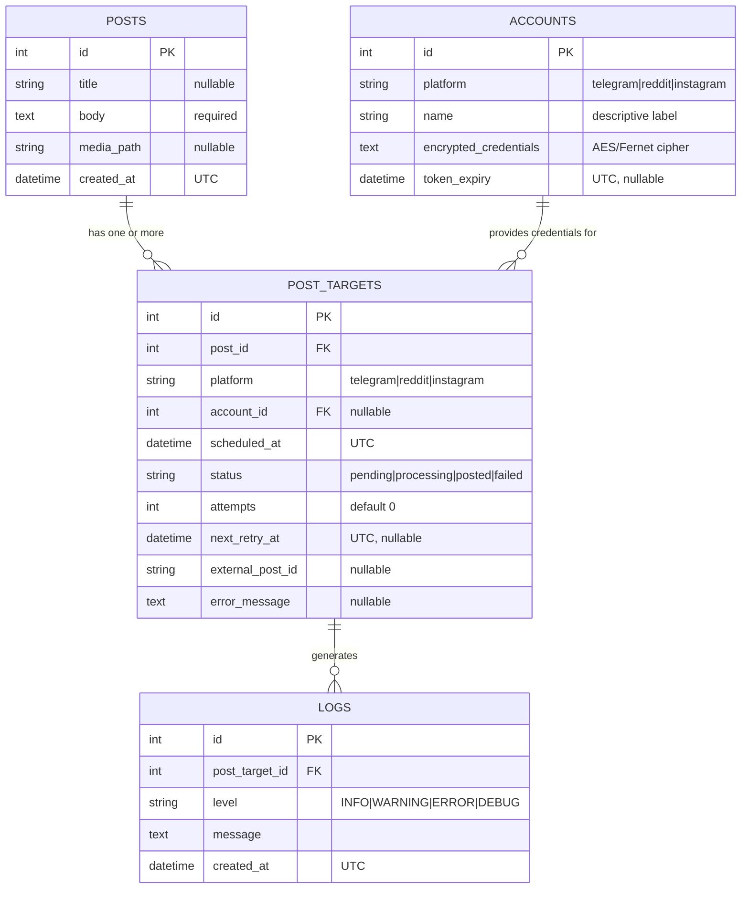
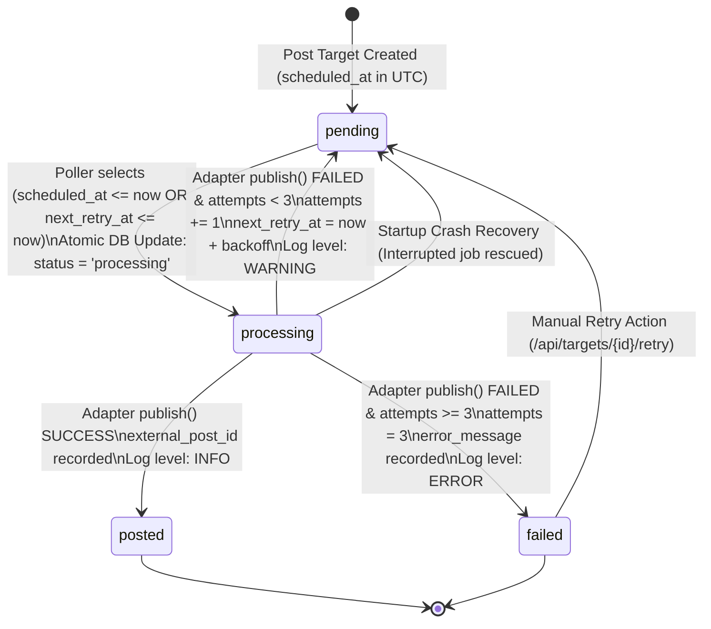

# Implementation Plan: Social Media Post Scheduler

**System Architecture & Implementation Plan**  
**Author:** Senior Backend Engineering Team  
**Status:** DRAFT (Awaiting User Review)  
**Target Environment:** Windows 10/11, Python 3.10+, Local execution  

---

## 1. Executive Summary & Core Requirements

This document specifies the technical design, database schema, component boundaries, execution flow, and step-by-step implementation phases for a local-first **Social Media Post Scheduler** built in Python.

### Core Goals:
1. **Multi-Platform Scheduling:** Compose a single post (text content, optional image/video) and schedule it for specific broadcast timestamps across multiple social platforms (**Telegram**, **Reddit**, **Instagram**).
2. **Reliable Automated Dispatch:** APScheduler running in-process polls the database every 60 seconds, claims pending posts using atomic transactions, and delegates publication to platform-specific adapters.
3. **Resilience & Fault Tolerance:** Automatic retry logic with exponential backoff (5 min, 15 min, 60 min; terminal failure after 3 attempts). Crash recovery on application startup for jobs interrupted mid-flight.
4. **Auditability & Observability:** Granular log records per target post attempt, structured execution traces, and status inspection endpoints.
5. **Clean Architecture & Extensibility:** Strict Adapter Pattern (`publish(post, target) -> PublishResult`). Adding support for any new platform requires adding exactly one adapter file without touching business logic or scheduling internals.
6. **Timezone Accuracy:** All timestamps are strictly stored in **UTC** in the database and converted to **IST (Asia/Kolkata)** exclusively at the presentation/display layer.

---

## 2. Directory & Package Structure

```text
social-scheduler/
├── .env.example              # Template for environment variables and secrets
├── .env                      # Local secret configuration (git-ignored)
├── .gitignore                # Git ignore rules for Python, SQLite, media, env
├── requirements.txt          # Pinned production and development dependencies
├── README.md                 # Project setup and usage instructions
├── PLAN.md                   # This implementation plan
├── main.py                   # FastAPI application factory and ASGI entrypoint
├── app/
│   ├── __init__.py
│   ├── config.py             # Pydantic BaseSettings, env parsing, timezone setup
│   ├── database.py           # SQLAlchemy 2.0 engine, SessionLocal, Base model
│   ├── api/                  # FastAPI routers (thin HTTP controllers)
│   │   ├── __init__.py
│   │   ├── deps.py           # Dependency injection (DB session, auth, services)
│   │   ├── posts.py          # Post CRUD, target attachments, and manual triggers
│   │   ├── targets.py        # PostTarget status query, manual retry triggers
│   │   ├── accounts.py       # Account credential registration and inspection
│   │   ├── logs.py           # Target audit logs and execution traces
│   │   └── dashboard.py      # Jinja2 HTML views (Phase 6)
│   ├── models/               # SQLAlchemy 2.0 Declarative Models
│   │   ├── __init__.py
│   │   ├── post.py           # Post entity
│   │   ├── target.py         # PostTarget entity (platform schedule & state)
│   │   ├── account.py        # Account credentials entity (encrypted)
│   │   └── log.py            # TargetLog execution history entity
│   ├── schemas/              # Pydantic v2 validation models & DTOs
│   │   ├── __init__.py
│   │   ├── post.py           # PostCreate, PostUpdate, PostResponse
│   │   ├── target.py         # TargetCreate, TargetResponse, TargetStatusUpdate
│   │   ├── account.py        # AccountCreate, AccountResponse (redacted secrets)
│   │   └── log.py            # LogEntryResponse
│   ├── services/             # Core business logic layer
│   │   ├── __init__.py
│   │   ├── post_service.py   # Post & target orchestration and validation
│   │   ├── crypto_service.py # AES/Fernet encryption for stored credentials
│   │   └── log_service.py    # Database logging handler for scheduler runs
│   ├── adapters/             # Platform publisher adapters (Adapter Pattern)
│   │   ├── __init__.py
│   │   ├── base.py           # Abstract Base Adapter & PublishResult definition
│   │   ├── registry.py       # Adapter registry & dynamic factory lookup
│   │   ├── telegram.py       # Telegram Bot API implementation (Phase 2)
│   │   ├── reddit.py         # PRAW Reddit implementation (Phase 5)
│   │   └── instagram.py      # Instagram Graph API implementation (Phase 7)
│   ├── scheduler/            # Background scheduling engine
│   │   ├── __init__.py
│   │   ├── engine.py         # APScheduler lifecycle and runner configuration
│   │   ├── worker.py         # Queue poller, atomic lock claims, and dispatch
│   │   └── recovery.py       # Startup crash recovery for orphaned 'processing' tasks
│   ├── templates/            # Jinja2 HTML templates for Web Dashboard (Phase 6)
│   │   ├── base.html
│   │   ├── dashboard.html
│   │   └── create_post.html
│   └── static/               # Static assets (CSS/JS) for dashboard
│       ├── css/
│       └── js/
├── media/                    # Local storage for post media attachments (images/videos)
└── tests/                    # Pytest automated test suite
    ├── __init__.py
    ├── conftest.py           # Test database fixtures, client overrides, mock adapters
    ├── unit/                 # Unit tests for crypto, adapters, state transitions
    │   ├── test_crypto.py
    │   ├── test_telegram_adapter.py
    │   └── test_state_machine.py
    └── integration/          # API endpoint tests and scheduler flow tests
        ├── test_api_posts.py
        └── test_scheduler_worker.py
```

### Folder Responsibilities (One-Line Descriptions):
- **`app/api`**: Exposes thin HTTP route handlers delegating requests to services.
- **`app/models`**: Defines SQLAlchemy ORM entities and database table relationships.
- **`app/schemas`**: Validates request payloads and formats outgoing JSON responses with Pydantic.
- **`app/services`**: Encapsulates business logic, credential encryption, and post workflows.
- **`app/adapters`**: Implements platform-specific publishing logic behind a unified interface.
- **`app/scheduler`**: Manages APScheduler background polling, atomic job claims, and retries.
- **`app/templates` & `app/static`**: Houses Jinja2 UI views and styling for the local web dashboard.
- **`tests`**: Contains automated unit and integration tests verifying API, state machine, and adapters.

---

## 3. Database Schema & Models (SQLAlchemy 2.x)

The database layer utilizes **SQLAlchemy 2.0 DeclarativeBase** with typed mapping (`Mapped`, `mapped_column`). Designed natively for SQLite with portable types (`DateTime(timezone=True)`, `String`, `Text`, `Integer`) enabling zero-friction migration to PostgreSQL via changing `DATABASE_URL`.



### Detailed Table Specifications

#### 1. `posts`
Represents the core creative content to be published.
- `id`: `INTEGER`, Primary Key, Autoincrement.
- `title`: `VARCHAR(255)`, Nullable. (Used as Reddit title, Instagram caption header, or Telegram message header).
- `body`: `TEXT`, Not Null. (The post body or caption).
- `media_path`: `VARCHAR(500)`, Nullable. (Local filesystem path or relative path inside `./media`).
- `created_at`: `DATETIME(timezone=True)`, Not Null, Default `func.now()` (UTC).
- **Relationships:**
  - `targets`: One-to-Many with `post_targets`, `cascade="all, delete-orphan"`.

#### 2. `accounts`
Holds platform authentication details and API tokens in encrypted format.
- `id`: `INTEGER`, Primary Key, Autoincrement.
- `platform`: `VARCHAR(50)`, Not Null, Index. (`"telegram"`, `"reddit"`, `"instagram"`).
- `name`: `VARCHAR(100)`, Not Null. (Human-readable identifier, e.g., `"TechChannel_Bot"`, `"Reddit_Personal"`).
- `encrypted_credentials`: `TEXT`, Not Null. (Fernet-encrypted JSON payload containing API tokens, client secrets, chat IDs).
- `token_expiry`: `DATETIME(timezone=True)`, Nullable (UTC). (Used for OAuth refresh tokens, e.g., Instagram long-lived tokens).
- **Relationships:**
  - `post_targets`: One-to-Many with `post_targets`.

#### 3. `post_targets`
Represents a scheduled dispatch of a post to a specific platform account.
- `id`: `INTEGER`, Primary Key, Autoincrement.
- `post_id`: `INTEGER`, Foreign Key referencing `posts.id` (`ondelete="CASCADE"`), Not Null, Index.
- `platform`: `VARCHAR(50)`, Not Null, Index.
- `account_id`: `INTEGER`, Foreign Key referencing `accounts.id` (`ondelete="SET NULL"`), Nullable, Index.
- `scheduled_at`: `DATETIME(timezone=True)`, Not Null, Index. (Intended publication time in UTC).
- `status`: `VARCHAR(20)`, Not Null, Default `"pending"`, Index. (Allowed values: `"pending"`, `"processing"`, `"posted"`, `"failed"`).
- `attempts`: `INTEGER`, Not Null, Default `0`. (Count of publish attempts made).
- `next_retry_at`: `DATETIME(timezone=True)`, Nullable, Index. (Next earliest dispatch time if retrying).
- `external_post_id`: `VARCHAR(255)`, Nullable. (ID/URL assigned by platform upon successful publishing).
- `error_message`: `TEXT`, Nullable. (Last encountered error traceback or summary).
- **Relationships:**
  - `post`: Many-to-One with `posts`.
  - `account`: Many-to-One with `accounts`.
  - `logs`: One-to-Many with `logs`, `cascade="all, delete-orphan"`.

#### 4. `logs`
Immutable execution and audit logs tied directly to specific target attempts.
- `id`: `INTEGER`, Primary Key, Autoincrement.
- `post_target_id`: `INTEGER`, Foreign Key referencing `post_targets.id` (`ondelete="CASCADE"`), Not Null, Index.
- `level`: `VARCHAR(20)`, Not Null. (`"INFO"`, `"WARNING"`, `"ERROR"`, `"DEBUG"`).
- `message`: `TEXT`, Not Null. (Descriptive log entry, redacted of secrets).
- `created_at`: `DATETIME(timezone=True)`, Not Null, Default `func.now()` (UTC).
- **Relationships:**
  - `post_target`: Many-to-One with `post_targets`.

---

## 4. API Endpoints Specification

All API paths are prefixed with `/api`. Payloads are strictly validated with Pydantic v2 schemas. Sensitive tokens are never returned in responses.

| Method | Endpoint | Purpose | Request Body / Params | Response Shape |
|---|---|---|---|---|
| `GET` | `/health` | System health check & scheduler status | None | `{"status": "ok", "utc_time": "...", "ist_time": "...", "scheduler_running": true}` |
| `POST` | `/api/posts` | Create new post and schedule targets | `PostCreateRequest` (title, body, media_path, targets: list of {platform, account_id, scheduled_at_ist}) | `PostDetailResponse` (id, title, body, media_path, created_at_ist, targets: [...]) |
| `GET` | `/api/posts` | List posts with pagination | Query params: `page=1`, `limit=20`, `platform=...` | `PostListResponse` (total, items: List[PostSummaryResponse]) |
| `GET` | `/api/posts/{id}` | Retrieve post details, targets & status | Path param: `id` | `PostDetailResponse` (with full targets and recent logs) |
| `DELETE` | `/api/posts/{id}` | Delete post and cancel pending targets | Path param: `id` | `{"message": "Post and associated pending targets cancelled."}` |
| `POST` | `/api/posts/{id}/publish-now` | Force immediate publish trigger | Path param: `id` | `{"message": "Targets marked for immediate execution."}` |
| `GET` | `/api/targets` | List targets filtered by status/date | Query params: `status`, `platform`, `date` | `TargetListResponse` (items: List[TargetResponse]) |
| `GET` | `/api/targets/{id}` | Get target status and execution logs | Path param: `id` | `TargetDetailResponse` (status, attempts, next_retry_at, logs: [...]) |
| `POST` | `/api/targets/{id}/retry` | Manually reset a failed target to pending | Path param: `id` | `TargetResponse` (status reset to "pending", attempts preserved or reset) |
| `POST` | `/api/accounts` | Register platform credentials (encrypted) | `AccountCreateRequest` (platform, name, credentials: dict) | `AccountResponse` (id, platform, name, token_expiry, credentials_configured: true) |
| `GET` | `/api/accounts` | List configured accounts (no secrets) | Query param: `platform` (optional) | `List[AccountResponse]` |
| `GET` | `/api/logs` | Query system logs | Query params: `target_id`, `level`, `limit` | `List[LogEntryResponse]` |
| `GET` | `/dashboard` | HTML Web Dashboard (Phase 6) | None | HTML page rendered via Jinja2 |

---

## 5. Platform Adapter Architecture (Adapter Pattern)

Every social media platform is encapsulated as an adapter adhering to a strict abstract interface. The rest of the application interacts solely through this interface.

### Adapter Interface Signature

```python
# app/adapters/base.py
from abc import ABC, abstractmethod
from dataclasses import dataclass
from typing import Optional, Dict, Any

@dataclass(frozen=True)
class PostDTO:
    """Read-only data transfer object passed to adapters."""
    id: int
    title: Optional[str]
    body: str
    media_path: Optional[str]

@dataclass(frozen=True)
class TargetDTO:
    """Read-only target context."""
    id: int
    platform: str
    account_id: Optional[int]

@dataclass(frozen=True)
class PublishResult:
    """Standardized response from platform adapters."""
    success: bool
    external_post_id: Optional[str] = None
    error_message: Optional[str] = None
    raw_response: Optional[Dict[str, Any]] = None

class BasePlatformAdapter(ABC):
    """
    Common contract for all social media adapters.
    Adding a new platform requires implementing only this interface.
    """

    @property
    @abstractmethod
    def platform_name(self) -> str:
        """Unique identifier matching accounts.platform and post_targets.platform."""
        pass

    @abstractmethod
    def publish(
        self,
        post: PostDTO,
        target: TargetDTO,
        credentials: Dict[str, Any]
    ) -> PublishResult:
        """
        Executes the publication to the external platform.
        Must catch platform-specific exceptions and return a PublishResult(success=False, error_message=...)
        rather than bubbling unhandled HTTP/SDK crashes.
        """
        pass

    @abstractmethod
    def validate_credentials(self, credentials: Dict[str, Any]) -> bool:
        """Verifies if the credentials dictionary possesses all mandatory keys."""
        pass
```

### Adapter Registry (Factory Pattern)

```python
# app/adapters/registry.py
from typing import Dict
from app.adapters.base import BasePlatformAdapter

class AdapterRegistry:
    _registry: Dict[str, BasePlatformAdapter] = {}

    @classmethod
    def register(cls, adapter: BasePlatformAdapter) -> None:
        cls._registry[adapter.platform_name.lower()] = adapter

    @classmethod
    def get(cls, platform: str) -> BasePlatformAdapter:
        adapter = cls._registry.get(platform.lower())
        if not adapter:
            raise ValueError(f"No adapter registered for platform: '{platform}'")
        return adapter
```

---

## 6. Scheduler & Retry State Machine

The scheduler runs in-process using APScheduler's `BackgroundScheduler`. Every 60 seconds, it invokes `poll_and_dispatch()`.

### State Transition Diagram



### State Machine Transition Rules

1. **`pending` -> `processing` (Atomic Claim):**
   - Query selects targets where `status == 'pending'` AND:
     `((next_retry_at IS NULL AND scheduled_at <= now_utc) OR (next_retry_at IS NOT NULL AND next_retry_at <= now_utc))`
   - Atomic database update:
     ```sql
     UPDATE post_targets 
     SET status = 'processing' 
     WHERE id = :target_id AND status = 'pending';
     ```
   - Only targets that successfully updated 1 row are processed. This completely prevents race conditions or duplicate posts.

2. **`processing` -> `posted` (Successful Completion):**
   - Triggered when `adapter.publish()` returns `PublishResult(success=True)`.
   - `status = 'posted'`, `external_post_id = result.external_post_id`, `error_message = None`.
   - Insert row into `logs` (`level='INFO'`).

3. **`processing` -> `pending` (Transient Failure & Retry Backoff):**
   - Triggered when `adapter.publish()` returns `PublishResult(success=False)` AND `attempts + 1 < 3`.
   - `attempts = attempts + 1`.
   - Backoff delay calculation:
     - **Attempt 1 failure:** Delay = 5 minutes (`next_retry_at = now_utc + 5 minutes`)
     - **Attempt 2 failure:** Delay = 15 minutes (`next_retry_at = now_utc + 15 minutes`)
   - `status = 'pending'`, `error_message = result.error_message`.
   - Insert row into `logs` (`level='WARNING'`).

4. **`processing` -> `failed` (Terminal Failure):**
   - Triggered when `adapter.publish()` returns `PublishResult(success=False)` AND `attempts + 1 >= 3`.
   - `attempts = 3`, `status = 'failed'`, `next_retry_at = None`, `error_message = result.error_message`.
   - Insert row into `logs` (`level='ERROR'`).

5. **`processing` -> `pending` (Crash Recovery on Startup):**
   - On application startup, `app.scheduler.recovery.recover_orphaned_jobs()` executes:
     - Scans for all targets with `status == 'processing'`.
     - Logs warning: `"System restart detected orphaned target {id}. Rescheduling with retry."`
     - Increments `attempts += 1`. If `attempts < 3`, sets status back to `'pending'` with `next_retry_at = now_utc + 1 minute`. If `attempts >= 3`, sets status to `'failed'`.

---

## 7. Dependencies List (`requirements.txt`)

```text
fastapi==0.110.0
uvicorn[standard]==0.28.0
python-multipart==0.0.9
pydantic==2.6.4
pydantic-settings==2.2.1
SQLAlchemy==2.0.28
apscheduler==3.10.4
python-dotenv==1.0.1
cryptography==42.0.5
pytz==2024.1
httpx==0.27.0
praw==7.7.1
jinja2==3.1.3
pytest==8.1.1
pytest-asyncio==0.23.5
```

---

## 8. Environment Variables (`.env.example`)

```bash
# Application & Environment
APP_ENV=development
DEBUG=True
PORT=8000

# Security (AES-256 via Fernet)
APP_SECRET_KEY=GENERATE_FERNET_KEY_HERE

# Database Configuration (SQLite default; switch to PostgreSQL easily)
DATABASE_URL=sqlite:///./social_scheduler.db

# Timezone Configuration (DB UTC; display in IST)
DISPLAY_TIMEZONE=Asia/Kolkata

# Scheduler Settings
SCHEDULER_POLL_INTERVAL_SECONDS=60
SCHEDULER_MAX_RETRIES=3

# Media Storage
MEDIA_UPLOAD_DIR=./media
MAX_MEDIA_SIZE_MB=50

# Platform Credentials (Optional defaults)
TELEGRAM_BOT_TOKEN=
TELEGRAM_DEFAULT_CHAT_ID=

REDDIT_CLIENT_ID=
REDDIT_CLIENT_SECRET=
REDDIT_USER_AGENT=python:social-scheduler:v1.0.0 (by /u/YOUR_REDDIT_USERNAME)
REDDIT_USERNAME=
REDDIT_PASSWORD=

INSTAGRAM_ACCESS_TOKEN=
INSTAGRAM_BUSINESS_ACCOUNT_ID=
```

---

## 9. Phased Implementation Roadmap

### Phase 1: Project Setup, FastAPI Base, SQLite & Models
- **Goal:** Establish repo structure, load configuration, initialize database connection, create ORM models and tables, verify FastAPI starts up and returns health check.
- **Files to Create:** `requirements.txt`, `.env.example`, `.env`, `app/config.py`, `app/database.py`, `app/models/*`, `app/schemas/*`, `app/services/crypto_service.py`, `app/api/deps.py`, `main.py`, `tests/conftest.py`, `tests/unit/test_crypto.py`.
- **How to Test This Phase:**
  1. Activate venv: `.\venv\Scripts\activate`.
  2. Install dependencies: `pip install -r requirements.txt`.
  3. Run server: `uvicorn main:app --reload`.
  4. Query `http://127.0.0.1:8000/health`: expect `{"status": "ok"}`.
  5. Confirm `posts`, `post_targets`, `accounts`, `logs` tables exist in SQLite database.
  6. Run `pytest tests/unit/test_crypto.py`.

### Phase 2: Telegram Adapter & Manual Test Publish
- **Goal:** Implement base adapter and Telegram adapter (supporting text, photo, video) using `httpx`, plus endpoint to manually trigger immediate publish.
- **Files to Create:** `app/adapters/base.py`, `app/adapters/registry.py`, `app/adapters/telegram.py`, `app/services/post_service.py`, `app/api/posts.py`, `tests/unit/test_telegram_adapter.py`.
- **How to Test This Phase:**
  1. Set Telegram bot token and chat ID in `.env`.
  2. Submit post via `POST /api/posts`.
  3. Call `POST /api/posts/1/publish-now`.
  4. Confirm message delivered to Telegram chat.
  5. Run `pytest tests/unit/test_telegram_adapter.py`.

### Phase 3: APScheduler & Automated Publishing
- **Goal:** Launch APScheduler on FastAPI lifespan to poll database every 60 seconds and auto-publish due targets.
- **Files to Create:** `app/scheduler/engine.py`, `app/scheduler/worker.py`, `app/scheduler/recovery.py`, `tests/integration/test_scheduler_worker.py`.
- **How to Test This Phase:**
  1. Start server: `uvicorn main:app`. Confirm scheduler starts in logs.
  2. Schedule a post for +1 minute in the future.
  3. Wait 60s and verify the worker automatically dispatches the message.
  4. Verify target status is updated to `"posted"`.

### Phase 4: Retries, Logs & Status Endpoints
- **Goal:** Implement retry backoff (5m -> 15m -> 60m), execution logging table records, and inspection endpoints.
- **Files to Create:** `app/services/log_service.py`, `app/api/targets.py`, `app/api/logs.py`, `tests/unit/test_state_machine.py`.
- **How to Test This Phase:**
  1. Trigger post with faulty credentials to simulate error.
  2. Observe status reverts to `pending` with `attempts = 1` and `next_retry_at = now + 5 min`.
  3. Check `GET /api/targets/{id}` and `GET /api/logs?target_id={id}`.
  4. Verify terminal failure after 3 attempts.
  5. Test `POST /api/targets/{id}/retry`.

### Phase 5: Reddit Adapter Integration
- **Goal:** Implement Reddit adapter using official `praw` for self-text posts and link/media posts.
- **Files to Create:** `app/adapters/reddit.py`, `tests/unit/test_reddit_adapter.py`.
- **How to Test This Phase:**
  1. Add Reddit script credentials to `.env`.
  2. Schedule post for Telegram and Reddit simultaneously.
  3. Verify Reddit post is published to the target subreddit.
  4. Run `pytest tests/unit/test_reddit_adapter.py`.

### Phase 6: Web Dashboard (HTML / Jinja2)
- **Goal:** Build a browser UI to create posts, upload media, view scheduled items, and inspect logs.
- **Files to Create:** `app/api/dashboard.py`, `app/templates/base.html`, `app/templates/dashboard.html`, `app/templates/create_post.html`, `app/static/css/styles.css`.
- **How to Test This Phase:**
  1. Open `http://127.0.0.1:8000/dashboard` in browser.
  2. Fill out post creation form with IST datetime.
  3. Observe live countdown, status transitions, and log view.

### Phase 7: Instagram Graph API Adapter
- **Goal:** Implement Instagram adapter using Meta Instagram Graph API (container creation & publish).
- **Files to Create:** `app/adapters/instagram.py`, `tests/unit/test_instagram_adapter.py`.
- **How to Test This Phase:**
  1. Configure Instagram Business Account ID and token.
  2. Publish post and verify image container creation and final publish.
  3. Handle token expiry detection and logging.
  4. Run `pytest tests/unit/test_instagram_adapter.py`.

---

## 10. Risks, Edge Cases & Mitigation Strategies

- **App Restart / Crash Mid-Processing:** Handled by `recovery.py` scanning for orphaned `processing` records on boot and re-enqueuing them.
- **Race Conditions / Duplicate Posts:** Handled by APScheduler `max_instances=1` and atomic database SQL update `UPDATE ... WHERE id = :id AND status = 'pending'`.
- **Timezone Drift:** All database datetimes stored in UTC. Ingestion normalizes all inputs to UTC. IST conversion occurs solely for display.
- **Instagram Public Media Requirement:** Instagram Graph API requires accessible image URLs; adapter checks and handles public image URL requirements.
- **Rate Limits (HTTP 429):** Adapters catch rate limits and delay `next_retry_at` per `Retry-After` headers.
- **Secrets Management:** Credentials encrypted at rest using AES-256 (Fernet), loaded from `.env`, never committed or exposed in API responses.

---
*End of Implementation Plan. Awaiting user review and approval.*

